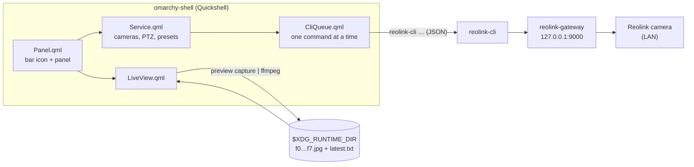

<div align="center">

# Reolink Cameras for Omarchy

**Your Reolink cameras in the [Omarchy](https://omarchy.org) bar: live view, pan/tilt, presets and snapshots.
Local network only. No cloud account, no browser, no extra server.**

[](https://github.com/opteon-sdc/omarchy-reolink-plugin/actions/workflows/ci.yml)
[](LICENSE)
[](https://omarchy.org)


<sub>Shown with the bundled demo camera (<code>tests/fake-reolink-cli</code>).</sub>

</div>

## Features

- **Live view** in a panel that opens from the bar, with sub and main streams
  and an adjustable frame rate. The stream only runs while the panel is open.
- **Several cameras.** Switch between every camera registered in `reolink-cli`.
- **Pan and tilt.** Hold an on-screen arrow to move and let go to stop. The arrow
  keys give short nudges, and the speed is adjustable.
- **Presets.** Jump to one with a click or a key from 1 to 9, save the current
  position under a name, or delete one.
- **Snapshots** at full resolution, saved to `~/Pictures/Reolink`, with a
  notification.
- **Feels like part of Omarchy.** It follows your theme and fonts, uses the
  shell's own panels and keyboard handling, and is translated (English, Dutch).
- **Scriptable.** `omarchy-shell reolink toggle` works from a keybinding.

The panel only shows pan/tilt controls when the selected camera supports them.

## Requirements

| | |
|---|---|
| [Omarchy](https://omarchy.org) | with the Quickshell-based `omarchy-shell` |
| [`reolink-cli`](https://github.com/reolink/reolink-cli) | Reolink's official LAN CLI; `setup` installs it if missing |
| `ffmpeg` | `setup` installs it if missing |
| A Reolink camera, NVR or Home Hub | reachable on your local network |

## Installation

```bash
omarchy plugin add https://github.com/opteon-sdc/omarchy-reolink-plugin --enable
~/.config/omarchy/plugins/io.github.opteon-sdc.reolink/setup
```

`omarchy plugin add` only copies the plugin into place. The `setup` script
then does three things:

1. It installs `ffmpeg` with `omarchy pkg add` if it is missing.
2. It installs `reolink-cli` with Reolink's own installer if it is missing. That
   installer verifies its download against a published checksum.
3. It runs the reolink-cli gateway as the user service `reolink-gateway.service`.
   The gateway listens on `127.0.0.1:9000` only.

### Register your cameras

`reolink-cli` keeps the camera list and stores passwords encrypted. Register
each camera once; the CLI asks for the password without echoing it:

```bash
reolink-cli discover        # find cameras on your LAN
reolink-cli device add living-room --host 192.168.1.40 --user admin
```

If `discover` finds nothing (a firewall can block its UDP replies), look up the
camera's IP address in your router or the Reolink app. For cameras behind an
NVR or Home Hub, add the hub and run `reolink-cli device expand <hub>`.

### Update and remove

```bash
omarchy plugin update io.github.opteon-sdc.reolink
omarchy plugin remove io.github.opteon-sdc.reolink
systemctl --user disable --now reolink-gateway.service   # optional
```

## Usage

Click the camera icon in the bar. To open the panel with a keyboard shortcut,
add this to `~/.config/hypr/bindings.lua`:

```lua
o.bind("SUPER + ALT + C", "Cameras", "omarchy-shell reolink toggle")
```

| Input | Action |
|---|---|
| Camera buttons, `C` | Switch camera |
| `Sub` / `Main`, `M` | Switch between the light and the full-resolution stream |
| Hold an on-screen arrow | Pan/tilt until you let go |
| Arrow keys | Short pan/tilt nudge |
| Preset button, `1`–`9` | Go to a preset |
| **+ Save current position** | Save the current position as a preset |
| Camera icon, `S` | Save a full-resolution snapshot |
| Refresh icon, `R` | Reload the camera list and restart the stream |
| `Esc` | Close the panel |

IPC: `omarchy-shell reolink open | close | toggle`.

## Settings

Open Omarchy's bar settings, or edit the `io.github.opteon-sdc.reolink` entry
in `~/.config/omarchy/shell.json`. For example:

```bash
omarchy bar set io.github.opteon-sdc.reolink defaultCamera living-room
```

| Key | Default | Description |
|---|---|---|
| `defaultCamera` | first camera | Camera shown when the panel opens |
| `stream` | `sub` | `sub` is lighter on CPU and network; `main` is full resolution |
| `fps` | `8` | Live frames per second (1–15) |
| `panelWidth` | `640` | Panel width in pixels (420–1400) |
| `cliPath` | `reolink-cli` on `PATH` | Path to `reolink-cli` |
| `snapshotDir` | `~/Pictures/Reolink` | Where snapshots are saved |

## How it works



- **Live view.** `reolink-cli preview capture` writes the camera's raw H.264 or
  H.265 to `ffmpeg`. `ffmpeg` detects the codec and writes JPEG frames in turn
  to eight files, and records the newest one in `latest.txt`. Two `Image`
  elements take turns loading the newest frame, so the picture never flickers.
  Because every frame has its own file name, no image cache can show an old
  picture.
- **Commands** go through `CliQueue`, which runs one `reolink-cli` process at a
  time and parses its JSON output. Because pan/tilt commands run in order, a
  `stop` can never overtake its `move`.

## Privacy and security

- **Local only.** Everything goes through `reolink-cli` and its gateway on
  `127.0.0.1`. No traffic leaves your network, and there is no telemetry.
- **Credentials** stay in `reolink-cli`'s encrypted registry. The plugin never
  sees or stores a password and never puts one on a command line.
- **Frames are temporary.** Live frames go to a private (`0700`) folder under
  `$XDG_RUNTIME_DIR`, which is RAM-backed. They are deleted when the panel
  closes, and the stream does not run while the panel is closed.
- **Untrusted text is plain text.** Camera and preset names come from devices,
  so every `Text` element uses `Text.PlainText`. Values are passed to processes
  as separate arguments and never placed inside shell code.

See [SECURITY.md](SECURITY.md) to report a vulnerability.

## Troubleshooting

| Symptom | Fix |
|---|---|
| "The reolink-cli gateway is not running" | Click **Start gateway**, or run `systemctl --user status reolink-gateway` |
| No cameras listed | `reolink-cli device list` must list them as enabled; the installer's examples are disabled |
| Stream error "device rejected command" | Check the camera with `reolink-cli --camera NAME info`; a battery camera may be asleep |
| High CPU use | Use the `sub` stream or a lower `fps` |
| Anything else | The shell log is in `/run/user/$UID/quickshell/by-id/*/log.log` |

## Development

```bash
git clone https://github.com/opteon-sdc/omarchy-reolink-plugin
cd omarchy-reolink-plugin
tests/check.sh            # static checks, also run in CI
```

To try the plugin without a camera, point it at the bundled fake CLI:

```bash
omarchy bar set io.github.opteon-sdc.reolink cliPath "$PWD/tests/fake-reolink-cli"
```

See [CONTRIBUTING.md](CONTRIBUTING.md) for the development loop.

## Disclaimer

This is an independent community project. It is not affiliated with, endorsed
by or sponsored by Reolink. "Reolink" is a trademark of its owner and is used
here only to say which devices the plugin works with. It builds on the separately
licensed [`reolink-cli`](https://github.com/reolink/reolink-cli), which is not
included. Use it only with cameras you own or are authorized to administer.

## License

[MIT](LICENSE) © 2026 opteon-sdc
